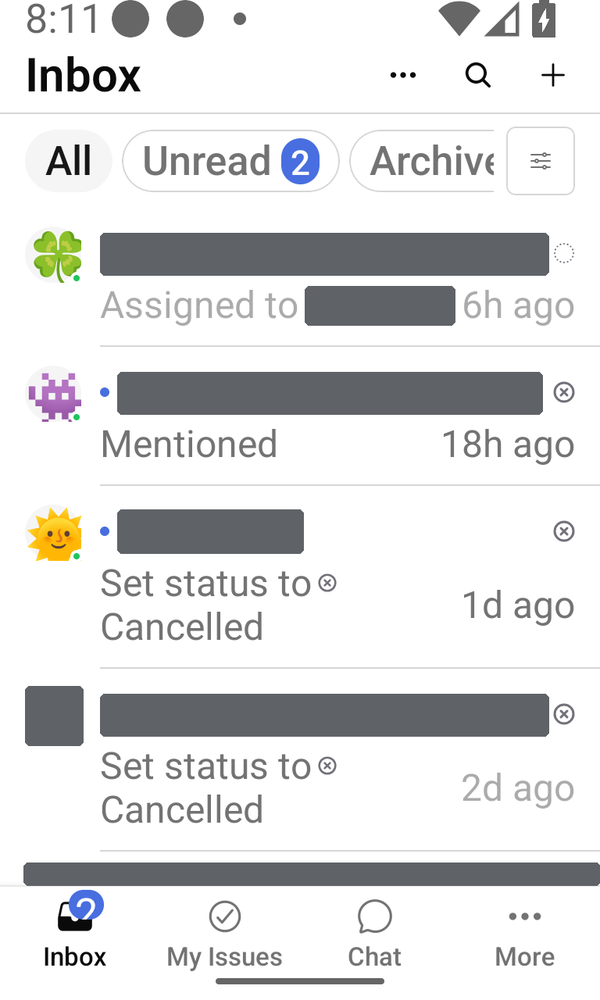
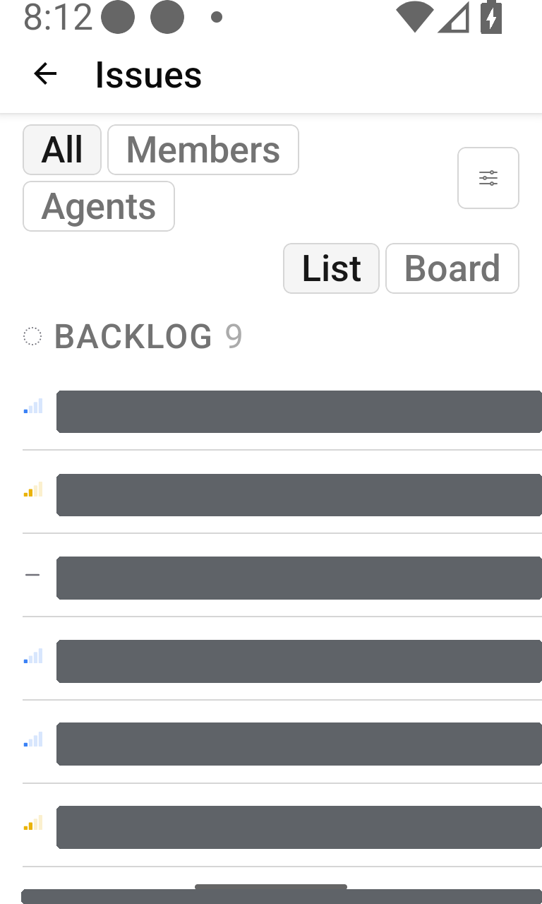
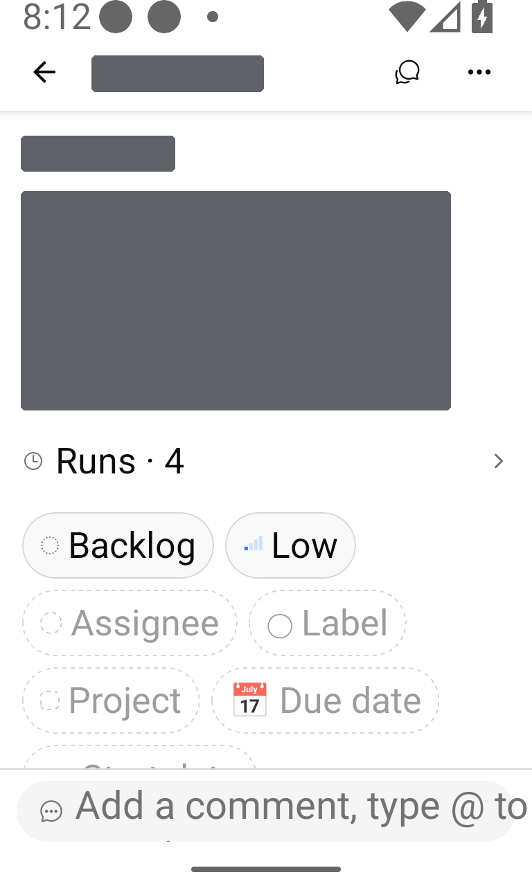
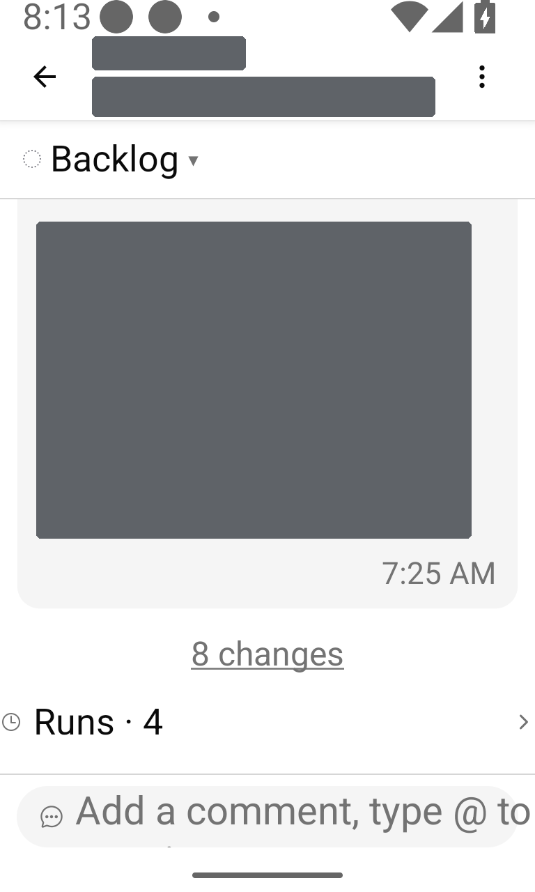
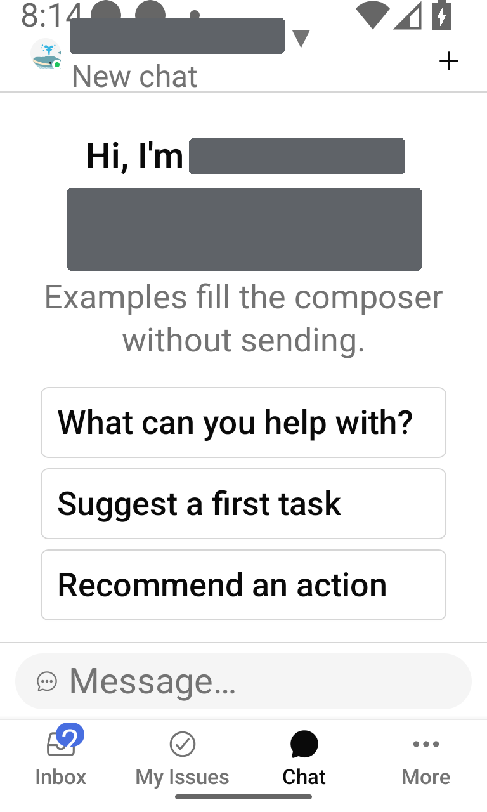

# Multica for Android (unofficial) – AI agent and task management app

> ⚠️ **Early release (v1.0.0).** This app was built fast and may have rough edges. It is **not extensively end-to-end tested**. It is functional and usable, but not state of the art. Known issues are being fixed for **v2.0.0** → [Known issues](KNOWN_ISSUES.md)

[](https://github.com/127001/multica-android-unofficial/releases)
[-blue)](LICENSE)
[](https://github.com/127001/multica-android-unofficial/releases)

**Multica for Android (unofficial)** is an open-source Android app for [Multica](https://github.com/multica-ai/multica), the platform where people and AI coding agents work on the same issues. Use it to follow your AI agents on the go: inbox and on-device notifications, issues and a Kanban board, comments, agent runs and agent chat, connected to your own Multica server – self-hosted or cloud.

> **Unofficial.** This project is not affiliated with or endorsed by Multica / Index Labs (Hong Kong) Limited, and it is not supported by them. "Multica" and the Multica logo belong to their owners and are used here only as required by the [Multica License](LICENSE).

The app is a fork of the official Expo / React Native mobile client (`apps/mobile`), which upstream ships for iOS only. This fork adds an Android build, Android-specific fixes and mobile features for task management with AI agents while you are away from your desk. The app has no backend of its own and contains no server address; you enter your server URL on first start.

## Screenshots

| Inbox | Board | Issue | Issue chat | Agent chat |
| --- | --- | --- | --- | --- |
|  |  |  |  |  |

## Features

**Inbox and notifications**
- Inbox with all notification types, live updates, unread and archive views, row and bulk actions.
- Filter by status, priority and sender; "Done" marks the issue done and archives its entries.
- Tapping an entry opens the issue chat or the issue detail depending on the type, and lands on the comment that triggered it.
- On-device notifications **without Firebase or Google Play Services**: an optional foreground service keeps one WebSocket connection to your server for all workspaces. Per-workspace switches, notification channels, mark-as-read from the notification. The service is off until you enable it.

**Issues and Kanban board**
- My Issues and All Issues with scopes, list grouped by status, and a **Kanban board** (status columns, status change with undo, drag and drop between columns in landscape and on tablets).
- Filters for status, priority, project, label and due date, remembered per list and workspace.
- Issue detail: title and description editing with conflict protection, status, priority, assignee, labels, project, start and due date, stage, parent, sub-issues grouped by stage with progress, mark as duplicate, custom properties.
- Comments with threads, reactions, resolve, edit and delete, mentions and attachments. Comments written offline are sent when the connection returns.
- **Issue chat**: a mobile-only, chat-style view of an issue's timeline next to the classic activity view.
- Subscribe/unsubscribe, subscriber list, agent runs with read-only transcripts (secrets redacted), cancel and re-run.
- Create issues, search issues and projects, pin issues and projects, copy link, open in web.

**Projects, agents and workspaces**
- Projects: list, detail, properties, resources, create, edit, delete, board and list of project issues.
- Agents and squads (read-only): status, runtime, recent runs, squad members and active issues.
- Workspace switcher, accept or decline workspace invitations.

**Chat with AI agents**
- Chat sessions with agent selection, attachments, mentions and stop.
- Rename, pin, archive, restore and delete sessions; archive view.
- Message queue while an agent is answering: send now (steer) or clear the queue.

**Android platform**
- Portrait and landscape, two-pane issue detail on tablets, layouts checked at 200 % font size, TalkBack labels and 48 dp touch targets.
- Material bottom sheets instead of iOS action sheets, Android date picker, keyboard-aware screens.
- Returns to the open screen after Android recreates the activity (font or display size change).
- English, German and Simplified Chinese.

**Connecting and security**
- Server URL entered at runtime with a connection test; nothing server-specific is built into the APK.
- Optional **Cloudflare Access** service-token mode for servers behind Cloudflare Zero Trust (headers on REST, uploads, WebSocket and images of your own origin only).
- **Local / VPN** mode for a direct connection; trusts CA certificates installed by the user on the device, so a private CA works without rebuilding the app.
- Secrets live in the Android Keystore (`expo-secure-store`), secret screens are protected against screenshots (`FLAG_SECURE`), the clipboard is cleared after pasting a secret, and logs redact tokens.
- No camera, microphone, storage or overlay permissions. Images use the system Photo Picker.

Not included on purpose: workspace administration, agent/skill/runtime/autopilot configuration, integrations, billing and analytics. Use the Multica web app for those.

## Requirements

- **Your own Multica instance** – self-hosted or Multica Cloud – and an account on it. The app was developed and tested against a self-hosted Multica server **v0.6.1**. Other server versions and Multica Cloud may work but are not tested.
- An Android phone or tablet with **Android 7.0 or newer** (API 24) and an **ARM** processor (`arm64-v8a` or `armeabi-v7a`). That covers practically all phones and tablets. x86 / x86_64 devices and x86 emulators are not supported by the release APK.

## Installation

Signed APKs are published on the [Releases](https://github.com/127001/multica-android-unofficial/releases) page. There is no Play Store release.

1. Download `multica-unofficial-<version>.apk` and its `.sha256` file from the release.
2. Check the checksum before installing:
   ```bash
   sha256sum -c multica-unofficial-<version>.apk.sha256
   ```
   Or compare the output of `sha256sum multica-unofficial-<version>.apk` with the SHA-256 in the release notes. On the phone, any file manager or checksum app that shows SHA-256 will do.
3. Open the APK on your phone. Android asks you to allow installs from this source: **Settings → Apps → Special app access → Install unknown apps**, pick your browser or file manager and turn on **Allow from this source** (the exact path differs between vendors; on Android 7 it is **Settings → Security → Unknown sources**).
4. Install, then turn the permission off again if you like.

Updates install over the previous version as long as they are signed with the same key.

## Connecting to your server

1. On first start, choose the connection mode:
   - **Local / VPN** – a direct connection to your server URL, e.g. `https://multica.example.com`. Use this for any server you can reach directly, on your LAN, over a VPN or on the internet.
   - **Cloudflare Access** – your server URL plus the client ID and secret of a Cloudflare Access *service token* (Zero Trust → Access → Service Auth → Service Tokens) that a *Service Auth* policy on your Access application allows.
2. Tap **Test connection**. The app calls `GET /health` and tells you whether the server answered, Access blocked the request, or the host is unreachable.
3. Sign in with the e-mail code, as in the web app.

Using a private CA: install the CA certificate on the phone (Settings → Security → Encryption & credentials → Install a certificate → CA certificate). Plain HTTP is not allowed.

You can change or forget the server later under **Settings → Server connection**. Changing the server signs you out.

## FAQ

**Is this the official Multica app?**
No. It is an independent, community-made Android port of the official mobile client. It is not affiliated with or endorsed by Multica / Index Labs. The app still shows Multica's name, logo and attribution, as the license requires. Please report problems with this app here, not in the Multica repository.

**Does it work with self-hosted Multica?**
Yes – that is what it was built and tested with (Multica v0.6.1). Enter your server URL on first start. Servers behind Cloudflare Access and servers with a private CA are supported as well.

**Does it work with Multica Cloud?**
It should, because the server URL is not built in, but the cloud has not been tested. Feedback is welcome.

**Why is there no Play Store release?**
This is an early, unofficial release made by volunteers. Distributing the APK through GitHub Releases keeps it simple and transparent: every release has a SHA-256 checksum, and you can build the same app from this repository yourself. A store release may be considered later.

**Which Android versions and devices are supported?**
Android 7.0 (API 24) or newer on ARM devices (`arm64-v8a`, `armeabi-v7a`), phones and tablets, portrait and landscape. x86 / x86_64 devices and emulators are not supported by the release APK; for an x86_64 emulator, build a debug APK from source. Day-to-day development and testing used Android 16 emulators; real-device coverage is limited.

**Is my data sent anywhere else?**
No. The app talks only to the Multica server you configure (plus Cloudflare, if you use the Cloudflare Access mode in front of your own server). There is no Firebase, no Google Play Services, no analytics or tracking, and no backend of this project. Notifications come from a WebSocket connection to your own server.

**How can I help or report bugs?**
Open an issue in this repository with your Android version, device, app version, Multica server version and the steps to reproduce. Please check [KNOWN_ISSUES.md](KNOWN_ISSUES.md) first. Pull requests are welcome (see [Build from source](#build-from-source)). Never post tokens, service-token secrets or server addresses you want to keep private.

## Roadmap

v1.0.0 is a first, early release. **v2.0.0** focuses on fixing the [known issues](KNOWN_ISSUES.md), more end-to-end tests, and more of the web app's filters, settings and management features. There are no dates yet.

## Build from source

Requirements: Node.js 22, pnpm (version from `packageManager` in `package.json`, via `corepack enable`), JDK 17, Android SDK with platform 36, build-tools 36 and NDK 27.

```bash
git clone https://github.com/127001/multica-android-unofficial.git
cd multica-android-unofficial
pnpm install --frozen-lockfile

# Checks (the same as CI)
pnpm --filter @multica/mobile typecheck
pnpm --filter @multica/mobile lint
pnpm --filter @multica/mobile test

# Debug APK for the emulator (x86_64); use --archs arm64-v8a for a phone
export ANDROID_HOME=/path/to/android-sdk JAVA_HOME=/path/to/jdk-17
apps/mobile/scripts/android-build.sh debug
# -> apps/mobile/android/app/build/outputs/apk/debug/app-debug.apk
```

Notes:
- Always build through `scripts/android-build.sh`. It runs `expo prebuild` (the `android/` folder is generated, not committed), checks that the native patches in `patches/` were applied, and verifies them in the finished APK.
- Run `pnpm install --frozen-lockfile` again after every pull; the build stops if the patched native dependencies are out of date.
- A signed release build uses `apps/mobile/scripts/build-release.sh` with your own keystore: point `RB_SIGNING_ENV` at a private file with the `RB_RELEASE_*` values (see the script header) and put the SHA-256 of your signing certificate into `apps/mobile/release-signer.sha256`. Never commit a keystore or its passwords.

## Relationship to Multica

- Upstream project: <https://github.com/multica-ai/multica>
- This app is based on the upstream mobile client at tag **v0.6.1**. Changes are listed in [CHANGELOG.md](CHANGELOG.md).
- We want to offer generally useful changes back to upstream as small pull requests. Product decisions, support for the Multica server, and the official apps stay with the Multica team.
- Please report problems with this app here, not in the Multica repository.

## License

This project is distributed under the **Multica License**, the same license as the upstream code: the Apache License 2.0 together with additional conditions (Part I). The full text is in [LICENSE](LICENSE).

In particular:
- The Multica logo, the Multica product name and the copyright and attribution information shown in the user interface are kept **unchanged**, as condition 1(b) requires. "Unofficial" in this README and the repository name only describes the project; the app itself still shows Multica's name, logo and attribution.
- The license does not allow operating a Multica-based hosted service for third parties without a commercial license from Index Labs. This app is a client; each server operator is responsible for their own license.
- **Modification notice** (Apache 2.0, section 4(b)): the files in this repository have been modified from the upstream Multica source. Changed and added files are listed in [MODIFICATIONS.md](MODIFICATIONS.md), changed areas in [CHANGELOG.md](CHANGELOG.md); the full history is in the Git log.
- Contributions to this repository are accepted under the same Multica License.

Copyright for the upstream code: Index Labs (Hong Kong) Limited and Multica contributors. Copyright for the changes in this fork: their respective authors.
