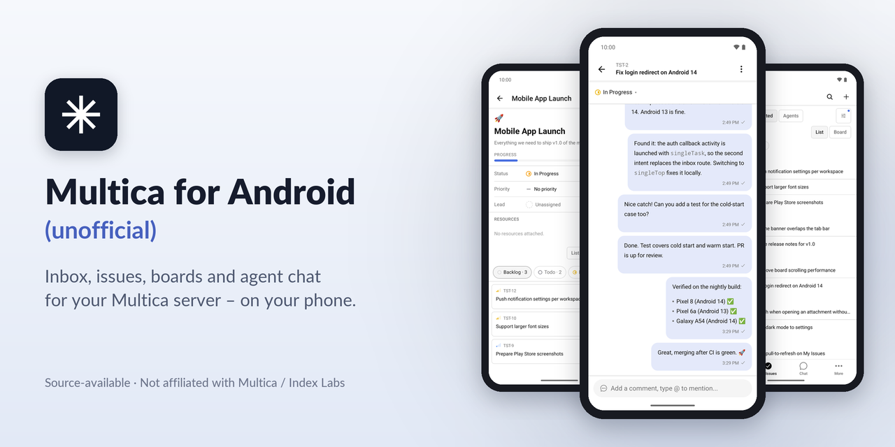
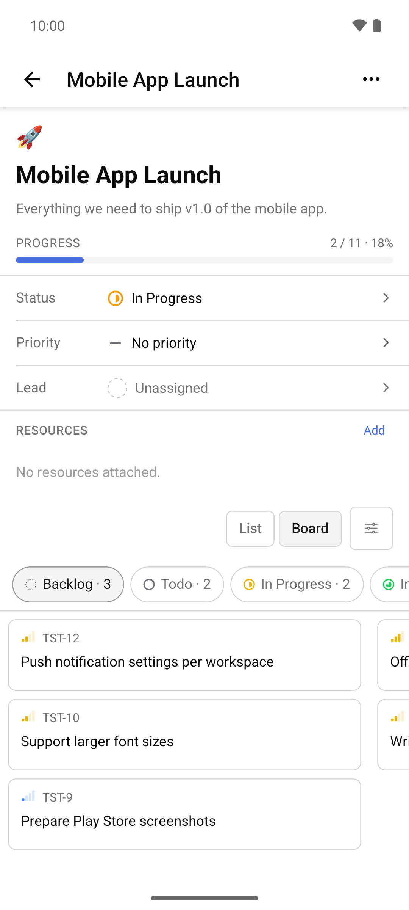
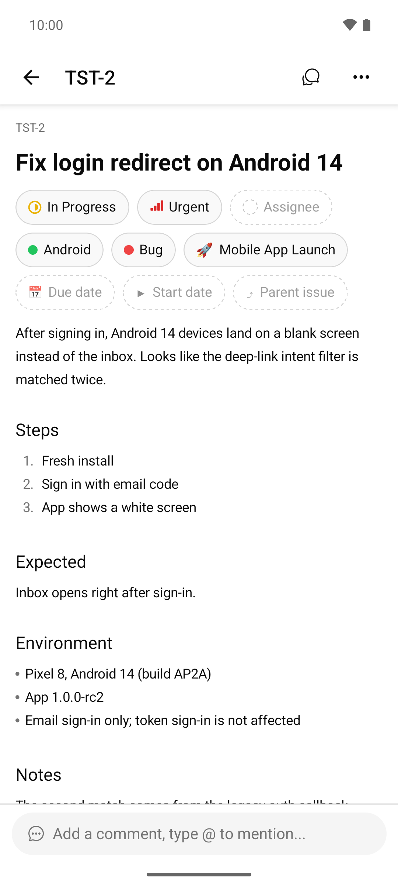
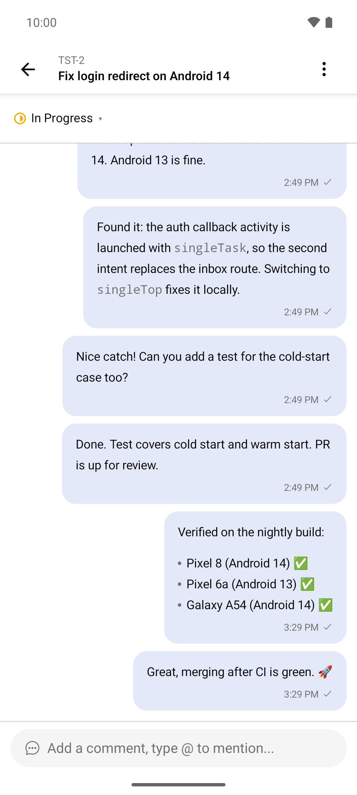
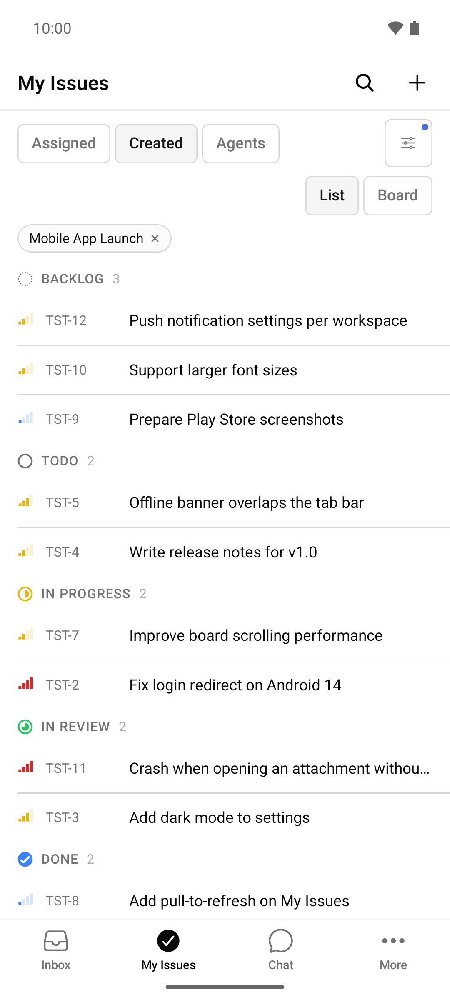
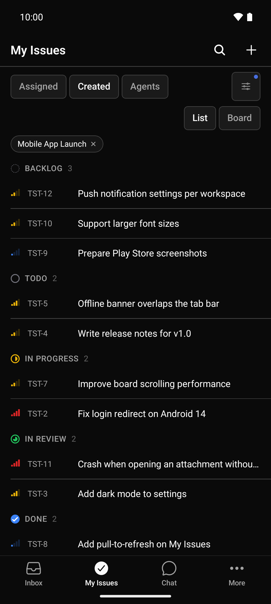

# Multica for Android (unofficial) – AI agent and task management app

<p align="center"></p>

> ⚠️ **Early release (v1.0.0).** This app was built fast and may have rough edges. It is **not extensively end-to-end tested**. It is functional and usable, but not state of the art. Known issues are being fixed for **v2.0.0** → [Known issues](KNOWN_ISSUES.md)

[](https://github.com/1270011/multica-android-unofficial/releases)
[-blue)](LICENSE)
[](https://github.com/1270011/multica-android-unofficial/releases)
[](https://1270011.github.io/multica-android-unofficial/)

**🌐 Website: [https://1270011.github.io/multica-android-unofficial/](https://1270011.github.io/multica-android-unofficial/)**

**Multica for Android (unofficial)** is a source-available (Multica License, Apache-2.0-based) Android app for [Multica](https://github.com/multica-ai/multica), the platform where people and AI coding agents work on the same issues. Use it to follow your AI agents on the go: inbox and on-device notifications, issues and a Kanban board, comments, agent runs and agent chat, connected to your own Multica server – self-hosted or cloud.

> **Unofficial.** This project is not affiliated with or endorsed by Multica / Index Labs (Hong Kong) Limited, and it is not supported by them. "Multica" and the Multica logo belong to their owners and are used here only as required by the [Multica License](LICENSE).

The app is a fork of the official Expo / React Native mobile client (`apps/mobile`), which upstream ships for iOS only. This fork adds an Android build, Android-specific fixes and mobile features for task management with AI agents while you are away from your desk. The app has no backend of its own and contains no server address; you enter your server URL on first start.

## Screenshots

| Board | Issue detail | Issue chat | My Issues | Dark mode |
| --- | --- | --- | --- | --- |
|  |  |  |  |  |

## Features

**Inbox and notifications**
- Inbox with all notification types, live updates, unread and archive views, row and bulk actions.
- Filter by status, priority and sender; "Done" marks the issue done and archives its entries.
- Tapping an entry opens the issue chat or the issue detail depending on the type, and lands on the comment that triggered it.
- On-device notifications **without Firebase or Google Play Services**: an optional foreground service keeps one WebSocket connection to your server for all workspaces. Per-workspace switches, notification channels, mark-as-read from the notification. The service is off until you enable it.

**Issues and Kanban board**
- My Issues and All Issues with scopes, list grouped by status, and a **Kanban board** (status columns, status change with undo, drag and drop between columns in landscape and on tablets).
- Filters for status, priority, project, label and due date, remembered per list and workspace.
- Issue detail: title and description editing with conflict protection, status, priority, assignee, labels, project, start and due date, stage, parent, sub-issues grouped by stage with progress, mark as duplicate, custom properties.
- Comments with threads, reactions, resolve, edit and delete, mentions and attachments. Comments written offline are sent when the connection returns.
- **Issue chat**: a mobile-only, chat-style view of an issue's timeline next to the classic activity view.
- Subscribe/unsubscribe, subscriber list, agent runs with read-only transcripts (secrets redacted), cancel and re-run.
- Create issues, search issues and projects, pin issues and projects, copy link, open in web.

**Projects, agents and workspaces**
- Projects: list, detail, properties, resources, create, edit, delete, board and list of project issues.
- Agents and squads (read-only): status, runtime, recent runs, squad members and active issues.
- Workspace switcher, accept or decline workspace invitations.

**Chat with AI agents**
- Chat sessions with agent selection, attachments, mentions and stop.
- Rename, pin, archive, restore and delete sessions; archive view.
- Message queue while an agent is answering: send now (steer) or clear the queue.

**Android platform**
- Portrait and landscape, two-pane issue detail on tablets, layouts checked at 200 % font size, TalkBack labels and 48 dp touch targets.
- Material bottom sheets instead of iOS action sheets, Android date picker, keyboard-aware screens.
- Returns to the open screen after Android recreates the activity (font or display size change).
- English, German and Simplified Chinese.

**Connecting and security**
- Server URL entered at runtime with a connection test; nothing server-specific is built into the APK.
- Optional **Cloudflare Access** service-token mode for servers behind Cloudflare Zero Trust (headers on REST, uploads, WebSocket and images of your own origin only).
- **Local / VPN** mode for a direct connection; trusts CA certificates installed by the user on the device, so a private CA works without rebuilding the app.
- Secrets live in the Android Keystore (`expo-secure-store`), secret screens are protected against screenshots (`FLAG_SECURE`), the clipboard is cleared after pasting a secret, and logs redact tokens.
- No camera, microphone, storage or overlay permissions. Images use the system Photo Picker.

Not included on purpose: workspace administration, agent/skill/runtime/autopilot configuration, integrations, billing and analytics. Use the Multica web app for those.

## Requirements

- **Your own Multica instance** – self-hosted or Multica Cloud – and an account on it. The app was developed and tested against a self-hosted Multica server **v0.6.1**. Other server versions and Multica Cloud may work but are not tested.
- An Android phone or tablet with **Android 7.0 or newer** (API 24) and an **ARM** processor (`arm64-v8a` or `armeabi-v7a`). That covers practically all phones and tablets. x86 / x86_64 devices and x86 emulators are not supported by the release APK.

## Installation

Signed APKs are published on the [Releases](https://github.com/1270011/multica-android-unofficial/releases) page. There is no Play Store release.

1. Download `multica-unofficial-<version>.apk` and its `.sha256` file from the release.
2. Check the checksum before installing:
   ```bash
   sha256sum -c multica-unofficial-<version>.apk.sha256
   ```
   Or compare the output of `sha256sum multica-unofficial-<version>.apk` with the SHA-256 in the release notes. On the phone, any file manager or checksum app that shows SHA-256 will do.
3. Open the APK on your phone. Android asks you to allow installs from this source: **Settings → Apps → Special app access → Install unknown apps**, pick your browser or file manager and turn on **Allow from this source** (the exact path differs between vendors; on Android 7 it is **Settings → Security → Unknown sources**).
4. Install, then turn the permission off again if you like.

Updates install over the previous version as long as they are signed with the same key.

## Connecting to your server

1. On first start, choose the connection mode:
   - **Local / VPN** – a direct connection to your server URL, e.g. `https://multica.example.com`. Use this for any server you can reach directly, on your LAN, over a VPN or on the internet.
   - **Cloudflare Access** – your server URL plus the client ID and secret of a Cloudflare Access *service token* (Zero Trust → Access → Service Auth → Service Tokens) that a *Service Auth* policy on your Access application allows.
2. Tap **Test connection**. The app calls `GET /health` and tells you whether the server answered, Access blocked the request, or the host is unreachable.
3. Sign in with the e-mail code, as in the web app.

Using a private CA: install the CA certificate on the phone (Settings → Security → Encryption & credentials → Install a certificate → CA certificate). Plain HTTP is not allowed.

You can change or forget the server later under **Settings → Server connection**. Changing the server signs you out.

## FAQ

**Is this the official Multica app?**
No. It is an independent, community-made Android port of the official mobile client. It is not affiliated with or endorsed by Multica / Index Labs. The app still shows Multica's name, logo and attribution, as the license requires. Please report problems with this app here, not in the Multica repository.

**Is it open source?**
Not in the OSI sense. The app is source-available (Multica License, Apache-2.0-based): the complete source is in this repository under the same license as upstream Multica – the Apache License 2.0 together with additional conditions. For example, Multica's name, logo and attribution must stay unchanged in the app, and running a Multica-based hosted service for third parties needs a commercial license from Index Labs. Within those terms you can read, build, modify and contribute to the code. See [License](#license).

**Does it work with self-hosted Multica?**
Yes – that is what it was built and tested with (Multica v0.6.1). Enter your server URL on first start. Servers behind Cloudflare Access and servers with a private CA are supported as well.

**Does it work with Multica Cloud?**
It should, because the server URL is not built in, but the cloud has not been tested. Feedback is welcome.

**Why is there no Play Store release?**
This is an early, unofficial release made by volunteers. Distributing the APK through GitHub Releases keeps it simple and transparent: every release has a SHA-256 checksum, and you can build the same app from this repository yourself. A store release may be considered later.

**Which Android versions and devices are supported?**
Android 7.0 (API 24) or newer on ARM devices (`arm64-v8a`, `armeabi-v7a`), phones and tablets, portrait and landscape. x86 / x86_64 devices and emulators are not supported by the release APK; for an x86_64 emulator, build a debug APK from source. Day-to-day development and testing used Android 16 emulators; real-device coverage is limited.

**Is my data sent anywhere else?**
No. The app talks only to the Multica server you configure (plus Cloudflare, if you use the Cloudflare Access mode in front of your own server). There is no Firebase, no Google Play Services, no analytics or tracking, and no backend of this project. Notifications come from a WebSocket connection to your own server.

**How can I help or report bugs?**
Open an issue in this repository with your Android version, device, app version, Multica server version and the steps to reproduce. Please check [KNOWN_ISSUES.md](KNOWN_ISSUES.md) first. Pull requests are welcome (see [Build from source](#build-from-source)). Never post tokens, service-token secrets or server addresses you want to keep private.

## In depth

<sub>Click a section to expand it.</sub>

<details>
<summary><b>All features in detail</b></summary>

<br>

**Inbox**
The inbox is the starting point of the app. It shows every notification type the Multica server sends and updates live over the WebSocket connection. You can switch between unread and archived entries, act on a single row or select several entries for a bulk action, and filter the list by status, priority and sender. The **Done** action marks the underlying issue as done and archives all of its inbox entries in one step. Tapping an entry opens either the issue chat or the issue detail, depending on the notification type, and scrolls to the comment that triggered the notification.

**On-device notifications without Google services**
Notifications do not use Firebase Cloud Messaging or Google Play Services. Instead, an optional Android foreground service keeps a single WebSocket connection to your own server, shared by all workspaces you enable. The app then shows local notifications with their own notification channels, a summary notification and a "mark as read" action. Each workspace has its own switch, and the service stays off until you turn it on. Its state survives process restarts and is deleted when you sign out.

**Issues, lists and the Kanban board**
*My Issues* and *All Issues* show your work grouped by status. Every list can also be shown as a **Kanban board** with one column per status. You change an issue's status from the board (with undo), and in landscape or on a tablet you can drag cards between columns. Filters for status, priority, project, label and due date are remembered per list and per workspace, and the filter button shows how many filters are active. Lists load all pages, so large workspaces are not cut off.

**Issue detail**
You can edit title and description; if someone else changed them in the meantime, the app shows a notice instead of silently overwriting their edit. Status, priority, assignee, labels, project, start and due date, stage and parent can be set directly. Sub-issues are grouped by stage with a progress indicator, an issue can be marked as a duplicate, and custom properties (text, number, select, multi-select, date, checkbox, URL, member) are supported. You can subscribe or unsubscribe, see the subscriber list, pin the issue, copy its link or open it in the web app.

**Comments and issue chat**
Comments support threads, reactions, resolving, editing and deleting your own comments, mentions and attachments. Comments you write without a connection are kept and sent automatically once the connection returns. In addition to the classic activity view, every issue has an **issue chat**: a mobile-only, chat-style view of the same timeline that is easier to follow on a small screen.

**Agent runs**
For each issue you can see the runs of AI agents that worked on it, with a read-only transcript (secrets are redacted) that updates live. You can cancel a running agent and start a re-run after a confirmation.

**Chat with AI agents**
Chat sessions let you talk to an agent directly: choose the agent, add attachments and mentions, and stop an answer while it is being written. Sessions can be renamed, pinned, archived, restored and deleted, and there is a separate archive view. While an agent is still answering, you can keep writing: messages go into a queue, and you can send one immediately to steer the agent or clear the queue.

**Projects, agents, squads and workspaces**
Projects can be listed, created, edited and deleted, with their properties, resources and their issues as a list or board. Agents and squads are shown read-only: status, runtime, recent runs, squad members and active issues. A workspace switcher lets you move between workspaces and accept or decline invitations. Search covers issues and projects; issues and projects can be pinned.

**Android platform and accessibility**
The app runs in portrait and landscape and shows a two-pane issue detail on tablets. It uses Material bottom sheets, the Android date picker and keyboard-aware screens. After Android recreates the activity, for example when you change the font or display size, the app returns to the screen you had open, including the back stack. Layouts are checked at 200 % font size, icons and controls have TalkBack labels, and touch targets are at least 48 dp. The interface is available in English, German and Simplified Chinese.

**Connection and security**
The server URL is entered at runtime and checked with a connection test; nothing server-specific is built into the APK. Servers behind Cloudflare Zero Trust are supported through a Cloudflare Access service token, whose headers are sent only to your own origin. The *Local / VPN* mode trusts CA certificates installed by the user, so a private CA works without rebuilding the app. Secrets are stored in the Android Keystore, secret screens block screenshots, the clipboard can be cleared after pasting a secret, and logs redact tokens. The app requests no camera, microphone, storage or overlay permission; images are picked with the system Photo Picker.

</details>

<details>
<summary><b>Use cases</b></summary>

<br>

**Steer AI coding agents while you are away from your desk**
Multica lets AI coding agents pick up issues, comment and report results. With this app you can follow those agents from your phone: see in the inbox when an agent has finished or needs input, read the run transcript, answer in the issue chat, re-run or cancel a run, or start a chat session with an agent and steer it while it is still answering. Small decisions no longer have to wait until you are back at your computer.

**Notifications on phones without Google services**
Because notifications come from a WebSocket connection to your own server, they also work on devices without Google Play Services – for example de-googled Android ROMs – and no notification content passes through a third-party push service. This is useful for privacy-conscious users and for teams that do not want issue titles or comments to leave their own infrastructure.

**Self-hosted teams**
Teams that run Multica on their own server, on a LAN, behind a VPN or behind Cloudflare Access can connect without a custom build: enter the URL, optionally a Cloudflare Access service token, or install a private CA certificate on the phone. Nothing about the server is built into the app, so the same APK works for every team.

**Triage on the go**
The inbox filters, bulk actions and the Kanban board make it quick to go through new notifications, move issues to the right status, reassign work or set a due date – for example on the way to work or between meetings.

</details>

<details>
<summary><b>How it compares</b></summary>

<br>

This app is a mobile client, not a replacement for the Multica web app. The table is a plain comparison of what each one is meant for.

| | Multica web app | This Android app |
| --- | --- | --- |
| Platform | Browser on desktop or laptop | Android 7.0+ phones and tablets (ARM) |
| Inbox and notifications | In the browser tab | Inbox plus optional on-device notifications via your own server's WebSocket, without Firebase |
| Issues, board, comments | Full | Full day-to-day use: fields, filters, board, threads, reactions, attachments |
| Issue chat view | – | Chat-style view of the issue timeline, made for small screens |
| Chat with agents | Yes | Yes, including message queue and steering |
| Agents, squads | View and configure | View only (status, runtime, runs, members) |
| Workspace administration, agent/skill/runtime/autopilot configuration, integrations, billing | Yes | Not included on purpose – use the web app |
| Offline comments | – | Written offline, sent when the connection returns |
| Origin | Official, by the Multica team | Unofficial community port of the official mobile client |

The official upstream mobile client is built for iOS only. This app is that client's Android port, with Android-specific fixes and additional mobile features.

</details>

<details>
<summary><b>Troubleshooting</b></summary>

<br>

**"Test connection" fails**
The connection test calls `GET /health` on your server and tells you which of three things happened:
- *Host unreachable* – check the URL (it must start with `https://`; plain HTTP is not allowed), your VPN or network, and that the server is running.
- *Blocked by Cloudflare Access* – the service token is missing or wrong, or no *Service Auth* policy on your Access application allows it. Paste the client ID and secret again; a copied header block fills both fields.
- *Server answered* – the connection works; continue with the sign-in.

**Certificate error with a private CA**
Install the CA certificate on the phone (Settings → Security → Encryption & credentials → Install a certificate → CA certificate) and use the *Local / VPN* mode. The app trusts user-installed CAs in this mode.

**The APK does not install**
- Allow installs from your browser or file manager (Settings → Apps → Special app access → Install unknown apps).
- The release APK is built for ARM (`arm64-v8a`, `armeabi-v7a`) only. It does not run on x86 / x86_64 devices or emulators; build a debug APK from source for those.
- An update installs over the previous version only if both are signed with the same key. If you built and installed the app yourself, uninstall it before installing a release APK.
- Check the SHA-256 checksum of the download (see [Installation](#installation)).

**No notifications in the background**
Turn on the notification service under **Settings → Notifications** and enable the workspaces you want notifications for. Allow notifications for the app in Android's settings. Some vendors stop background services aggressively – exclude the app from battery optimisation.

**Content looks stale or the offline bar is wrong**
The offline indicator is not always accurate in v1.0.0 (see [Known issues](KNOWN_ISSUES.md)). Pull to refresh. Comments written while offline are kept and sent later.

**The paste button is hidden by the keyboard**
Close the keyboard to reach it, or long-press the input field and paste.

**Signed out after changing the server**
This is intended: changing or forgetting the server under **Settings → Server connection** signs you out. Sign in again with the e-mail code.

**Something else**
Check [KNOWN_ISSUES.md](KNOWN_ISSUES.md), then open an issue with your Android version, device, app version, Multica server version and the steps to reproduce. Never post tokens or secrets.

</details>

<details>
<summary><b>FAQ / Related searches</b></summary>

<br>

**Is there a Multica Android app?**
The Multica team ships its official mobile client for iOS only. This repository provides an unofficial Android version of that client. It is a community port and is not affiliated with or endorsed by Multica / Index Labs. APKs are on the [Releases](https://github.com/1270011/multica-android-unofficial/releases) page.

**Is there a Multica mobile client for Android phones and tablets?**
Yes, this app. It runs on Android 7.0 or newer on ARM phones and tablets, in portrait and landscape, with a two-pane layout on tablets.

**How can I manage AI coding agents from my phone?**
Connect the app to your Multica server. You then see agent results and questions in the inbox, can read run transcripts, reply in the issue chat, re-run or cancel runs, change status and assignees, and chat with an agent directly. See [Use cases](#in-depth).

**Can I follow Claude Code agents on Android?**
Multica can run AI coding agents such as Claude Code on its runtimes. Whatever agents your Multica server runs, this app shows their issues, comments, runs and chat sessions on Android. The app itself does not run agents; it is a client for your Multica server.

**Is there a self-hosted issue tracker Android app for Multica?**
Yes. The app was built and tested against a self-hosted Multica server (v0.6.1). It contains no server address; you enter your own URL, and it supports servers on a LAN, behind a VPN, behind Cloudflare Access or with a private CA.

**Does it need Google Play Services or Firebase?**
No. Notifications come from a WebSocket connection to your own server.

**Is this app open source?**
It is source-available. The complete source is in this repository under the Multica License, which is the Apache License 2.0 together with additional conditions (for example on branding and hosted services), so it is not an OSI-approved license. See [License](#license).

**Is this app free?**
Yes. There is no paid version, no account with this project and no in-app purchase. You need your own Multica instance or a Multica Cloud account.

**What is planned next?**
v1.0.0 is an early release. v2.0.0 focuses on fixing the [known issues](KNOWN_ISSUES.md), more end-to-end tests, and more of the web app's filters, settings and management features.

<sub>Multica for Android (unofficial) is not affiliated with or endorsed by Multica / Index Labs (Hong Kong) Limited.</sub>

</details>

## Roadmap

v1.0.0 is a first, early release. **v2.0.0** focuses on fixing the [known issues](KNOWN_ISSUES.md), more end-to-end tests, and more of the web app's filters, settings and management features. There are no dates yet.

## Build from source

Requirements: Node.js 22, pnpm (version from `packageManager` in `package.json`, via `corepack enable`), JDK 17, Android SDK with platform 36, build-tools 36 and NDK 27.

```bash
git clone https://github.com/1270011/multica-android-unofficial.git
cd multica-android-unofficial
pnpm install --frozen-lockfile

# Checks (the same as CI)
pnpm --filter @multica/mobile typecheck
pnpm --filter @multica/mobile lint
pnpm --filter @multica/mobile test

# Debug APK for the emulator (x86_64); use --archs arm64-v8a for a phone
export ANDROID_HOME=/path/to/android-sdk JAVA_HOME=/path/to/jdk-17
apps/mobile/scripts/android-build.sh debug
# -> apps/mobile/android/app/build/outputs/apk/debug/app-debug.apk
```

Notes:
- Always build through `scripts/android-build.sh`. It runs `expo prebuild` (the `android/` folder is generated, not committed), checks that the native patches in `patches/` were applied, and verifies them in the finished APK.
- Run `pnpm install --frozen-lockfile` again after every pull; the build stops if the patched native dependencies are out of date.
- A signed release build uses `apps/mobile/scripts/build-release.sh` with your own keystore: point `RB_SIGNING_ENV` at a private file with the `RB_RELEASE_*` values (see the script header) and put the SHA-256 of your signing certificate into `apps/mobile/release-signer.sha256`. Never commit a keystore or its passwords.

## Relationship to Multica

- Upstream project: <https://github.com/multica-ai/multica>
- This app is based on the upstream mobile client at tag **v0.6.1**. Changes are listed in [CHANGELOG.md](CHANGELOG.md).
- We want to offer generally useful changes back to upstream as small pull requests. Product decisions, support for the Multica server, and the official apps stay with the Multica team.
- Please report problems with this app here, not in the Multica repository.

## Maintainer

Maintained by [Recordingbeats](https://recordingbeats.com).

## License

This project is distributed under the **Multica License**, the same license as the upstream code: the Apache License 2.0 together with additional conditions (Part I). The full text is in [LICENSE](LICENSE).

In particular:
- The Multica logo, the Multica product name and the copyright and attribution information shown in the user interface are kept **unchanged**, as condition 1(b) requires. "Unofficial" in this README and the repository name only describes the project; the app itself still shows Multica's name, logo and attribution.
- The license does not allow operating a Multica-based hosted service for third parties without a commercial license from Index Labs. This app is a client; each server operator is responsible for their own license.
- **Modification notice** (Apache 2.0, section 4(b)): the files in this repository have been modified from the upstream Multica source. Changed and added files are listed in [MODIFICATIONS.md](MODIFICATIONS.md), changed areas in [CHANGELOG.md](CHANGELOG.md); the full history is in the Git log.
- Contributions to this repository are accepted under the same Multica License.

Copyright for the upstream code: Index Labs (Hong Kong) Limited and Multica contributors. Copyright for the changes in this fork: their respective authors.
